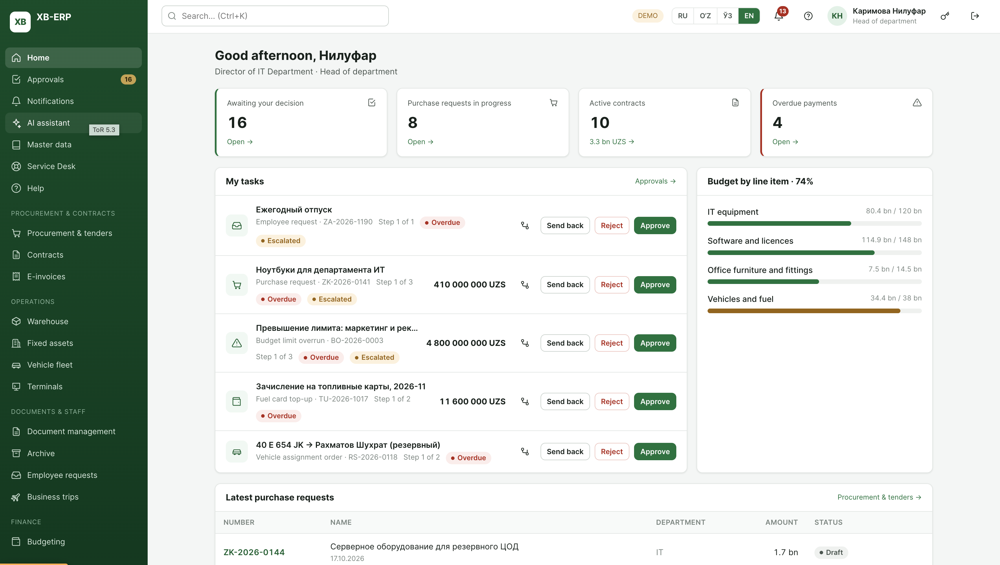
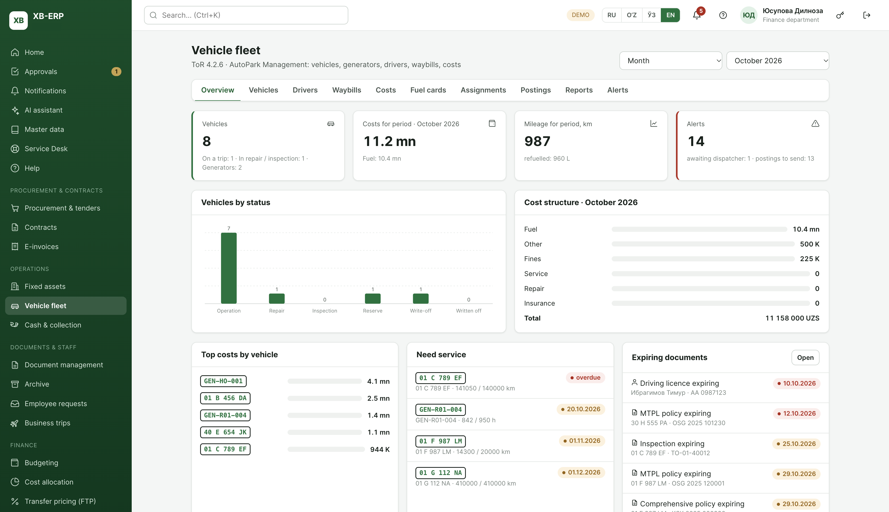

<div align="center">

# XB-ERP

**An enterprise resource planning platform built for banks**

Procurement, contracts, warehouse, fixed assets, fleet, cash, documents, budgeting, transfer pricing, taxes, IFRS and analytics: 30+ modules in one system, with approval workflows, role-based security and full audit.


</div>





---

## Contents

- [Overview](#overview)
- [Key capabilities](#key-capabilities)
- [Modules](#modules)
- [Platform services](#platform-services)
- [Security and compliance](#security-and-compliance)
- [Roles and demo users](#roles-and-demo-users)
- [Architecture](#architecture)
- [Getting started](#getting-started)
- [Deployment](#deployment)
- [Testing](#testing)
- [Roadmap](#roadmap)

---

## Overview

XB-ERP covers a bank's internal operations: buying goods and services, managing contracts and suppliers, running warehouses, fixed assets and the vehicle fleet, handling cash and collection, documents and archives, and the financial side: budgeting, cost allocation, funds transfer pricing, taxes, IFRS consolidation and management reporting.

It is designed for a large bank: a head office, regional branches, and hundreds of banking service centres. The system supports more than 10,000 cost centres, multi-step approvals with escalation and SLAs, a four-language interface, and an audit trail on every change.

| | |
|---|---|
| **Functional modules** | 30+ business and administration modules |
| **Approval document types** | 25, all on one configurable workflow engine |
| **Roles** | 19 roles with a least-privilege access matrix |
| **External integrations** | 20+ (core banking, tax authority e-invoicing, treasury, DWH/BI, Active Directory, Service Desk, booking systems and more) |
| **Interface languages** | Russian, Uzbek (Latin), Uzbek (Cyrillic), English |
| **Codebase** | ~100k lines of TypeScript across 360+ files |
| **Automated checks** | 25 end-to-end suites, 2,131 browser checks |

---

## Key capabilities

- **One approval engine for everything.** Route templates with conditions such as amount, document type, department or branch. Supports sequential and parallel steps, the initiator's manager, branch roles, committees and boards, SLAs with escalation, deputies, and send-back-for-rework. Separation of duties is enforced: nobody can approve their own document.
- **Budget control built in.** Every purchase, payment, trip and contract is checked against the budget line. Funds are reserved, consumed and released. Hard limits block overspend, and overruns go to their own approval route.
- **Organisation structure and cost centres.** Head office → regional branches → banking service centres → departments. Cost centres are versioned (SCD-2), so you can view the structure as of any date.
- **Electronic signature.** E-IMZO-style signing of documents, acts and approvals, with signature verification and QR codes on printed forms that link to a verification page.
- **Integration bus.** Every external call goes through one hub, which provides queueing when a system is down, retries, idempotency, quarantine of bad messages, reconciliation and a live monitor.
- **Everything exportable.** Excel and CSV export, printable forms and PDFs, and an import wizard with validation for bulk data.
- **AI assistant.** Natural-language search and help across modules.
- **Responsive.** Works down to 390 px phone width; wide tables scroll inside their cards.

---

## Modules

### Core

| Module | What it does |
|---|---|
| **Home** | Personal dashboard by role: tasks awaiting your decision, requests in progress, active contracts, overdue payments, budget execution by line item, latest requests. |
| **Approvals** | Unified inbox for all 25 document types. Approve, reject with a reason, send back, comment, request information, view the route. Overdue and escalated items are flagged. |
| **Notifications** | Bell and notification centre: deadlines, decisions, escalations, maintenance windows. |
| **AI assistant** | Conversational search and guidance across the system. |
| **Master data** | Nomenclature, counterparties and reference books. Changes go through an approval matrix by item type, signed by the approver; an item becomes active only after final approval. Org units and cost centres are versioned. |
| **Service Desk** | Raise incidents and requests that are sent to the IT Service Desk, with status sync and confirmation on resolution. |
| **Help** | Built-in user guide in all four languages: getting started, approvals, and an article for every module. A "?" button on each page opens the article for that module. |

### Procurement and contracts

| Module | What it does |
|---|---|
| **Procurement & tenders** | Purchase requests from employees and branches, method recommendation (direct, quotation, tender), consolidation, tenders with bid evaluation and winner selection, supplier register with blacklist, exchange quotes, acceptance of goods and works, claims, procurement monitoring dashboard, savings analysis and reports. |
| **Contracts** | Contract register by type (supply, services, construction, rent and more), legal and financial approval, payment schedule and payment marking, amendments, execution tracking, a dashboard by contract type, links to acceptance acts and e-invoices. |
| **E-invoices** | Incoming and outgoing electronic invoices exchanged with the tax authority's e-invoicing system: signing, rejection, approval, reconciliation against acceptance acts and contracts, duplicate protection. |

### Operations

| Module | What it does |
|---|---|
| **Warehouse** | Multi-warehouse stock, receipts from procurement, issues to employees, transfers, write-offs with signed acts, inventory counts with an offline queue, batches and expiry dates, slow-moving stock report with configurable thresholds (overall and per category), alerts and monitoring. |
| **Fixed assets** | Asset register, receipt into service from the warehouse, transfers between units and branches by approved order, depreciation, revaluation, write-off acts, assigned responsible persons, QR labels. |
| **Vehicle fleet** | Vehicles and generators, drivers and licences, waybills, fuel cards and top-ups, assignments, costs (fuel, service, repair, insurance, fines), accounting postings, expiry alerts for licences, insurance and inspections, reports. |
| **Terminals** | ATMs, POS and payment terminals as fixed assets: serial-number control, moves between service centres, maintenance requests, write-off, and sync with the core banking system. |
| **Cash & collection** | Cash desks, cash operations and limits, collection routes, day closing, rules for mini-bank offices, datasets for analytics. |

### Documents and staff

| Module | What it does |
|---|---|
| **Document management** | Incoming, outgoing and internal documents, resolutions and assignments, deadlines and control, signing, payments by document. |
| **Archive** | Accepting files into the archive, storage periods, classification, search with access by confidentiality level, issue and return, destruction acts. |
| **Employee requests** | Requests for supplies from the warehouse with reservation, issue and receipt confirmation, plus HR requests (leave and others). |
| **Business trips** | Trip requests and approval, per-diem and accommodation norms, cash advances, air and rail tickets and hotels booked through connected booking systems (norm and budget checks, e-ticket and voucher documents, cancellation with refund), expense reports. |

### Finance

| Module | What it does |
|---|---|
| **Budgeting** | Budget lines by cost centre, zero-based budgeting, change requests, overrun approvals, capital expenditure requests, execution monitoring, reservations and actuals from all modules. |
| **Cost allocation** | Allocation rules and drivers, calculation runs, results by product, segment, channel and branch. |
| **Transfer pricing (FTP)** | Rate curves received from the data warehouse with validation, reconciliation and versioning, plus control and scenario calculations. |
| **Taxes** | Tax registers, tax returns calculated from the ledger and a rate register, payment calendar, reconciliation. |
| **IFRS & subsidiaries** | IFRS adjustments (including IFRS 16 leases), subsidiary reporting packages, consolidation. |

### Analytics

| Module | What it does |
|---|---|
| **Reporting & analytics** | Report catalogue, scheduled reports and subscriptions, export to Excel and PDF, data marts sent to the DWH/BI. |
| **Operations analysis** | Product profitability: direct costs, allocated costs, expected losses and FTP by product, segment, channel and branch. |

### Administration

| Module | What it does |
|---|---|
| **Users** | User accounts, positions and org-unit binding, activation and deactivation, Active Directory sync with a preview of changes, mapping of AD groups to roles. |
| **Roles & permissions** | The role × module access matrix (none / view / edit / approve / admin), with changes from the default highlighted, and special rights. |
| **Security** | Password policy, 2FA, lockout and idle timeout, active sessions with forced sign-out, service accounts per integration (secrets as vault references, rotation tracking), DLP rules. |
| **Approval routes** | Visual route designer: conditions, steps, parallel groups, SLAs, escalation. |
| **Audit log** | Tamper-evident hash-chained log of every action with field-level diffs. Retention policy with archiving and destruction under two-person control. |
| **Personal data** | Register of personal-data categories (fields, purpose, legal basis, retention period), anonymisation of records past retention with dual approval, masking of passport, ID, phone and e-mail for roles without the right to see them. |
| **Integrations** | Monitor of all external systems and exchanges, plus an integration designer (REST, SOAP, file, MQ; operations with field mapping, schedule, retry policy, test calls, OpenAPI export). |
| **Import** | Import wizard with validation, preview and error report. |
| **Print forms** | Templates for cards, acts and registers, with QR verification. |
| **Monitoring** | System health, technical log with event IDs, incidents (pushed to the Service Desk). |
| **Maintenance** | Planned maintenance windows, which must be booked at least 5 working days ahead and approved; users get notifications and a banner; emergency read-only mode. |

---

## Platform services

Shared services that every module uses, so behaviour is consistent across the system:

| Service | Description |
|---|---|
| Access control | `can(user, module, level)` and the `useCan()` hook; step-up 2FA confirmation for risky actions. |
| Org structure | Versioned hierarchy and cost centres, "as of date" queries, business segments and sales channels. |
| Approval engine | Route templates, conditions, parallel steps, SLAs, escalation, delegation, send-back and resubmit. |
| Notifications | Targeted by user or role, localised titles, deadline scanner. |
| Audit | Hash chain, field diffs, per-record change history. |
| Documents | Excel/CSV export, import, print and PDF, QR codes, attachments, electronic signature. |
| Integration hub | Queue, retries, idempotency, quarantine, reconciliation, monitor. |
| Localisation | Typed dictionaries in RU / UZ / EN; Uzbek Cyrillic is generated automatically from Latin; locale-aware money and number formatting; translated error codes. |

---

## Security and compliance

- **Authentication:** password, one-time code (2FA), single sign-on via a government ID provider, and Active Directory domain login. Includes lockout after failed attempts, idle timeout, a concurrent-session limit and session management.
- **Authorisation:** an explicit least-privilege matrix for every role. New or unclassified sections are closed by default. Every action button checks the right, and route guards protect every page.
- **Separation of duties:** an initiator cannot approve their own document, even as an administrator. Sensitive operations need a second person.
- **Audit:** every create, update, approve, sign, export and failed access is logged in a hash-chained journal that can be verified for integrity.
- **Personal data:** a register of personal data, masking, and anonymisation by retention period.
- **Production build:** a build flag removes the demo quick login, the demo password and code hints from the bundle (see [Production mode](#production-mode)).

---

## Roles and demo users

The demo has a quick-login list on the sign-in screen: pick a user and sign in. One-time codes for confirming risky actions are shown as hints in demo mode.

| User | Role | Good for trying |
|---|---|---|
| Азизов Бекзод | Employee | Purchase requests, employee requests, business trips |
| Каримова Нилуфар | Head of department | Approvals, budget of the department |
| Рахимов Жасур | Procurement | Tenders, suppliers, contracts, nomenclature |
| Юсупова Дилноза | Finance | Budget, payments, allocation, FTP, IFRS |
| Ташкентов Шерзод | Legal | Contract approval, documents |
| Хасанова Малика | Chief accountant | E-invoices, assets, warehouse, taxes |
| Абдурахмонова Феруза | Accountant | Accounting documents |
| Ергашев Сардор | Treasury | Cash, terminals, transfer pricing |
| Исмоилова Гулноза | Analyst | Reporting, view-only finance |
| Турсунов Акмал | Cashier | Cash operations |
| Сафарова Дилфуза | HR | Employee requests, trips |
| Холматов Улугбек | Storekeeper | Warehouse operations |
| Норкулов Бахтиёр | Driver | Waybills |
| Каримов Рустам | Archivist | Archive |
| Худойбердиева Нигора | Tax officer | Taxes, e-invoices |
| Султанов Тимур | Support | Technical support views |
| Рашидова Зарина | Internal auditor | Audit log, read-only controls |
| Мирзаев Отабек | Administrator | Everything, including settings |

To switch users, sign out with the icon at the top right. Refreshing the page resets the demo data.

### Demo scenario: from purchase request to payment

1. **Азизов Бекзод** (employee): Procurement → New request (method "Tender") → send for approval.
2. Approve in turn as **Каримова Нилуфар** (head) → **Юсупова Дилноза** (finance) → **Рахимов Жасур** (procurement).
3. **Рахимов Жасур**: on the request card choose "Announce tender" → "Tenders" tab → "Select as winner" → "Conclude contract".
4. Approve the contract as **Ташкентов Шерзод** (legal) → **Юсупова Дилноза** (finance).
5. **Юсупова Дилноза**: on the contract card choose "Mark payment". Budget execution on the home page updates.

---

## Architecture

```
xb-erp/
├── packages/shared/          Domain layer (TypeScript), shared by web and mobile
│   └── src/
│       ├── types.ts          Core domain types
│       ├── engine.ts         Approval engine
│       ├── security.ts       Roles, access matrix, authentication
│       ├── org.ts            Org structure, cost centres (SCD-2)
│       ├── audit.ts          Hash-chained audit log
│       ├── services/         Export, import, print, QR, files, signature, integration hub
│       ├── api/              Core APIs: procurement, contracts, requests, master data
│       └── modules/<id>/     One folder per business module: types, data, api, i18n
├── apps/web/                 Web app (React 19 + Vite)
│   └── src/
│       ├── components/ui.tsx UI kit (tables, forms, charts, modals, route steps…)
│       ├── modules.tsx       Module registry: menu, groups, routes
│       └── pages/<id>/       Screens of each module
└── apps/mobile/              Mobile app (Expo / React Native): approvals and requests
```

**How it fits together**

- **Screens only talk to APIs.** Every module exposes a typed API (`warehouseApi`, `procApi`, …). Screens never touch data directly, and modules talk to each other only through these public APIs.
- **The API layer is the backend contract.** Today the APIs run in memory with realistic demo data and simulated latency, so the whole system works with no server. A backend (Java 17 / Spring Boot 3 or .NET 8, PostgreSQL) implements the same contract, and the screens don't change.
- **Reactive updates.** Mutations emit events on a small bus, and screens re-query automatically.
- **Money** is stored as integer amounts with a separate currency field, and formatted per locale.
- **UI kit.** All screens use one component layer with an Ant Design–style API, so the system can move to a standard component library without touching screens.

Developer rules are in [CLAUDE.md](CLAUDE.md), and the platform services guide is in [PLATFORM.md](PLATFORM.md).

---

## Getting started

**Requirements:** Node.js 20 or newer.

```bash
git clone <your-repo-url> xb-erp
cd xb-erp
npm install
npm run web          # opens http://localhost:5173
```

### Scripts

| Command | Description |
|---|---|
| `npm run web` | Start the web app in development mode |
| `npm run build:vite -w @xb/web` | Production build of the web app to `apps/web/dist` |
| `npm run preview -w @xb/web` | Serve the production build locally |
| `npm run web:build` | Type-check, then build |
| `npm run mobile` | Start the mobile app (Expo) |
| `npm run typecheck` | Type-check all packages |

### Production mode

By default the app builds as a demo stand, with quick login, the demo password and code hints. A production build removes all of these:

```bash
VITE_XB_MODE=production npm run build:vite -w @xb/web
```

In production mode, sign-in requires a login, a password set by an administrator, and a one-time code. This mode is meant to be used together with a real backend.

---

## Deployment

The web app is a static site with hash-based routing (`#/…`), so it runs on any static host with no rewrite rules.

**Vercel:** the repository includes `vercel.json`. Import the repo in Vercel, keep the repository root as the project root, and deploy. Alternatively, from the project folder:

```bash
npx vercel          # preview deployment
npx vercel --prod   # production
```

Demo deployments are open to anyone with the link, so turn on deployment protection (password or SSO) in the hosting settings before sharing.

**Other hosts:** run `npm run build:vite -w @xb/web` and serve `apps/web/dist`.

---

## Testing

Quality is checked by end-to-end browser suites (Playwright) that sign in as different roles and walk through real scenarios. They create and approve documents, check calculations, signatures, exports, notifications and integrations, verify role gating, check all four languages for untranslated text, check 390 px layouts, and fail on console errors.

The latest full run: **25 suites, 2,131 checks, all passing.**

---

## Roadmap

- **Backend services:** Java 17 / Spring Boot 3 or .NET 8, PostgreSQL, message broker, OAuth 2.0 / OIDC, implementing the existing API contract.
- **Native mobile apps:** inventory (NFC and QR scanning, offline mode) and driver (waybills, GPS tracking, offline sync), with push notifications and biometric login.
- **Standard component library:** move the UI kit to Ant Design.
- **Infrastructure:** clustering for 10,000+ users, 99.9% availability, backups and disaster recovery, penetration testing.

---

<div align="center">

Proprietary software. All rights reserved.

</div>
# erp_bank_system
